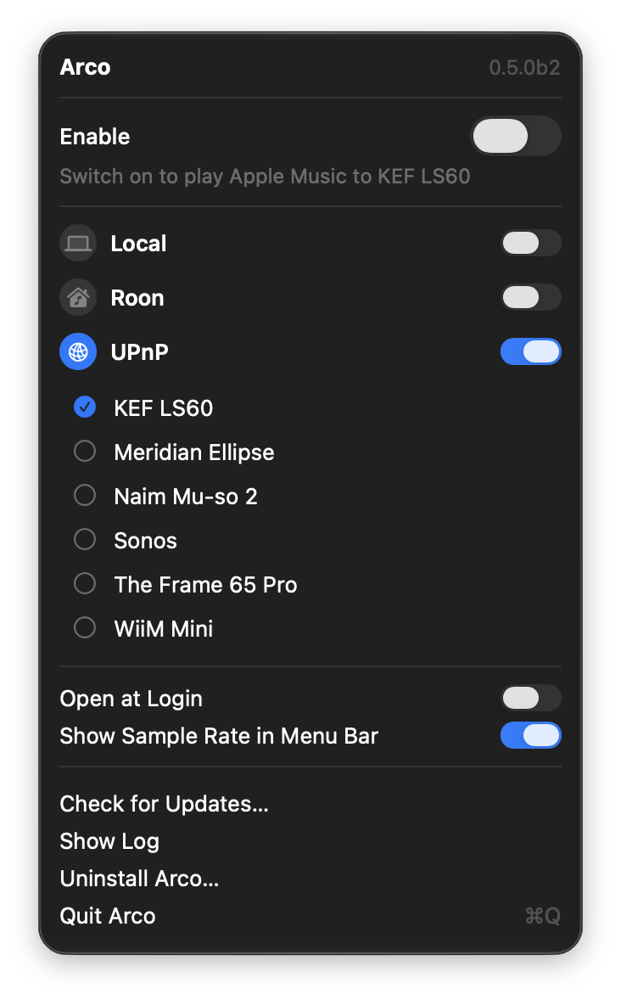

# Arco

Play Apple Music and Spotify on your Roon zones, from a small app in your Mac's menu bar.

Arco takes what the Music app or Spotify plays on your Mac and hands it to Roon as a live source, with the
title, artist, album and cover of each track. Roon does the rest: your zones, your DSP, your endpoints — including the
ones that only speak RAAT. Arco can also play to UPnP and OpenHome renderers on your network, or to a DAC on the Mac
itself.

<p align="center"></p>

> **Status:** beta. It works well in daily use here; expect rough edges, and please report them.

## What you get

- **Any Roon zone, from the menu bar.** Pick the zone, switch on *Enable*, press play in Music or Spotify. The
  Roon app doesn't need to be open — a laptop on your lap with Music is enough.
- **Apple Music and Spotify.** Arco follows whichever of the two plays. Spotify always arrives at 44.1 kHz; the clock
  per track below is for the Music app.
- **Also without Roon.** UPnP and OpenHome renderers (a Linn, a WiiM, HQPlayer) get a stream per track, gapless also
  across a change of sample rate where the renderer allows it. Under *Local*, a DAC on the Mac follows each track's rate.
- **A clock per track.** Arco sets its output to each track's own sample rate, so a 44.1 kHz track arrives in Roon
  at 44.1 and the next 96 kHz track at 96. The Music app doesn't change the rate by itself. The menu shows the rate
  Roon receives.
- **Gapless** between tracks at the same rate — a live album or a classical work plays through without a seam.
- **What's playing, in Roon:** title, artist, album and cover per track. Roon's play, pause, next and previous buttons
  work, and so does the zone's volume, in Roon or in Arco's menu. They are passed on to Music or Spotify.
- **A fixed 96 kHz per zone,** if you prefer one continuous stream over a clock per track: the Music app then
  resamples whatever isn't 96 kHz, and Roon never starts a new stream for a change of rate. Off by default.
- **Updates** arrive through the app itself (Sparkle), as signed and notarized packages.

## Requirements

- macOS 14 Sonoma or later, on Apple silicon or Intel — macOS 27 works best (see *Which macOS* below); tested mostly
  on Apple silicon, reports from Intel Macs are very welcome
- For Roon zones: a Roon Core on the same network (Roon 2.x)
- The Music app with an Apple Music subscription, and/or the Spotify app
- For the clock per track: in Music › Settings › Playback, set *Audio Quality* to **Lossless** (up to 24-bit/192 kHz
  for hi-res).

### Which macOS

Arco learns each track's sample rate, and the next track, from what the Music app writes in the system log. How much
it writes depends on the version of macOS:

- **macOS 27** — the Music app names the next track and its format well ahead. Arco sets the clock before the track
  starts, and announces the next track to a renderer in time. At volume 100 the Music app's output measured bit-exact.
- **macOS 26** — works the same way. The Music app's output measured just short of bit-exact at volume 100: about 97% of
  the samples exact, the rest off by one bit at most.
- **macOS 15 and earlier** — the Music app writes far less. A change of rate can come a few seconds into the track
  (those seconds resampled), and a UPnP renderer may pause briefly between tracks because the next one wasn't known in
  time. Playing at one rate goes smoothly; on a Roon zone, a fixed 96 kHz avoids the changes. There won't be further fixes
  for these versions.

Spotify doesn't depend on any of this: it always plays at 44.1 kHz.

## Install

1. Download `Arco-<version>.pkg` from [Releases](https://github.com/renebouwmeester/arco/releases) and open it.
2. The installer puts **Arco** in Applications and its **audio driver** in `/Library/Audio/Plug-Ins/HAL`. It asks for
   an administrator password, and restarts the Mac's audio for a moment.
3. Arco opens in the menu bar with a short *Get started* list:
   - **Audio driver** — installed by the package.
   - **Microphone access** — Arco reads its *own* audio output back (the music Music plays to it). macOS files that
     under the microphone; Arco never listens to a microphone.
   - **Control Music** (and Spotify, when it runs) — to follow what plays and pass on Roon's buttons.
   - **Enabled in Roon** — in Roon, open *Settings › Extensions* and press *Enable* next to *Arco on <your Mac>* — once
     for each Mac (Roon remembers it after that, also through updates).

The list goes away once everything is in place. *Open at login* is a checkbox in the menu.

macOS also asks once whether Arco may find devices on your **local network** — allow it, or Arco can't find the Roon
Core or UPnP renderers. Answered *Don't Allow* earlier? Switch Arco on under *System Settings › Privacy & Security ›
Local Network*.

## Use

1. Pick where to play in the menu: a Roon zone, a UPnP renderer, or a DAC on this Mac (under *Local*).
2. Switch on **Enable**. Arco becomes the Mac's sound output.
3. Press play in Music or Spotify.

Switch it off and the Mac gets its own output back. Switching zones while it plays moves the music to the new zone.

## Good to know

On Roon zones:

- Roon plays a few seconds behind the Music app: Roon keeps a buffer of the live stream, as it does for any source.
- Next and previous take a few seconds to be heard: Roon starts a new stream and has to buffer it as the music comes in
  (a file from Qobuz it can fetch ahead; a live source it can't).
- A change of sample rate between two tracks is a fresh start in Roon — gapless holds between tracks at the same rate.
  Arco pauses the Music app there for a moment, changes the clock and starts the track again from its first note.
- Roon's progress bar counts through a stretch of tracks at the same rate rather than the current track alone; the title,
  artist and cover change with each track.
- At 192 kHz a stretch holds about an hour of music (a WAV file's limit); a longer album continues in a new one, starting
  between two tracks.
- Hi-res needs a steady connection from Roon to the endpoint: a speaker on a weak wifi link may drop out at 192 kHz
  (in Roon, *Device Setup › Max Sample Rate* helps).
- Seeking within a track in Music or Spotify isn't passed on to Roon.

Everywhere:

- Your Apple Music or Spotify library doesn't appear in Roon: you choose in Music or Spotify, Roon (or the renderer)
  plays it.
- While Arco is on, it is the Mac's sound output: sound from other apps (a video in the browser) goes along too. Sound
  effects follow *System Settings › Sound › Play sound effects through* — set it to the Mac's own speakers and they
  stay on the Mac.

## Uninstall

Choose **Uninstall Arco…** in the menu. It removes the app and the driver (with an administrator password), restarts
the Mac's audio, and clears Arco's settings, log and permissions. Remove the extension in Roon's *Settings ›
Extensions* as well.

## Problems and ideas

- **Arco stays on "Looking for Roon…" or says "Can't find Roon"** (or finds no UPnP renderers) — almost always macOS'
  permission for the local network. Open *System Settings › Privacy & Security › Local Network* and switch Arco on, then
  switch Arco off and on in its menu. Is the Core on another network (a VPN, a second subnet)? Arco looks through every
  network connection of the Mac, as the Roon app does, but it can only find a Core it can reach.
- Arco keeps a log — **Show Log** in the menu opens it in Finder (`~/Library/Logs/Arco/arco.log`); it helps a lot with a bug report. It contains track titles and
  local network addresses — look it over before you share it.
- [Report a problem or suggest something](https://github.com/renebouwmeester/arco/issues/new/choose), or ask in
  [Discussions](https://github.com/renebouwmeester/arco/discussions).

## How it works

- **The Arco output** — a virtual audio device (an AudioServerPlugIn). Music plays to it; nothing leaves your Mac until
  Arco sends it on.
- **The bridge** — Arco reads that output back (bit for bit what Music produced), cuts it into runs of tracks at the
  same rate and serves them to your Roon Core over your local network.
- **The extension** — Arco registers with your Roon Core and uses Roon's audio input API to play the stream on the zone
  you pick, with the information of each track. Roon's transport buttons come back to Arco, which passes them on to
  the Music app or Spotify.

## Building from source

Needs Xcode and [XcodeGen](https://github.com/yonaskolb/XcodeGen) (`brew install xcodegen`).

```sh
./build.sh          # generate the project, build, and run Arco from build/
./build.sh driver   # build the audio driver; install it with: sudo build/driver/install.sh
./build.sh check    # build only
```

`release.sh` builds the signed and notarized package, `publish.sh` puts it on GitHub (both need the maintainer's
certificates and keys). The icons are drawn by `Design/make-icons.swift`.

## License

Apache License 2.0 — see [LICENSE](LICENSE).

Arco is an independent project. It is not affiliated with or endorsed by Roon Labs or Apple. Roon and Apple Music are
trademarks of their respective owners.
